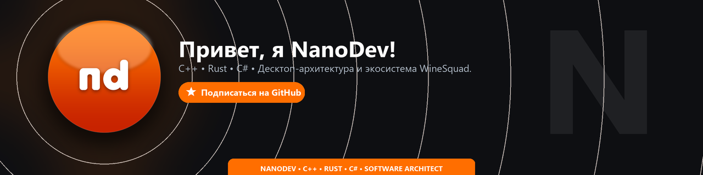

  

  
  
  
  
  
  

---

### ⚡ О себе
Привет! Я **NanoDev** (`nanodevmc`) — независимый разработчик и программный архитектор, автор экосистемы **WineSquad**.

Специализируюсь на нативном коде, системной производительности и современных десктопных средах:
* 🦀 **Системный уровень & High Performance:** разработка оптимизированных модулей и быстрых алгоритмов на **C++** и **Rust**.
* 🖥️ **Десктопные платформы & Инструменты:** создание нативных приложений на **C#** (.NET) и **Tauri v2** в концепции Liquid Glass / Material Design 3.
* 🤖 **Сервисы & Асинхронные пайплайны:** разработка микросервисов, интеграций и инфраструктурных ботов на **Python** (async).

---

### 🌐 Сообщество и связь
* 📢 **Официальный Telegram-канал:** [t.me/WineSquad](https://t.me/WineSquad)
* 💬 **Прямой контакт:** [t.me/radoqi](https://t.me/radoqi)
* 🐙 **GitHub:** [github.com/nanodevmc](https://github.com/nanodevmc)

  <i>«Инновации в каждой строке кода»</i>

